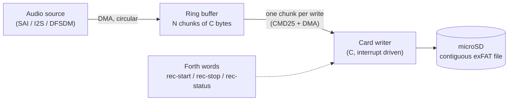

# Recording to the microSD card

Design note, draft, 2026-10-15. A production unit streams raw audio to
the microSD card at 0.5 MB/s, or 1 MB/s where the card allows it. This
note covers the data path, the buffer and where it lives, the card
driver, files on exFAT, the RF64 header, power loss, and choosing and
qualifying the card. The security side is
in [security-plan.md](admin/security-plan.md), section 5.8.

Items marked **Decide** are open; **Verify** marks things to check on
real parts. Section 11 collects them.

## 1. Requirements and decisions

| | |
|---|---|
| Rate | 0.5 MB/s sustained, raw audio, as the baseline; 1 MB/s where the card allows it (section 4) |
| File system | exFAT, through FatFs (ChaN) |
| File format | WAV, becoming RF64 past 4 GB (a WAV file's 32-bit sizes stop there: about 70 minutes at 1 MB/s, 2 h 20 min at 0.5 MB/s) |
| Files | Pre-expanded as one contiguous run, so streaming never touches the allocation bitmap or a cluster chain |
| Card | A specified part whose worst-case write latency is known (section 9) |
| Buffer | From the RAM pool, shared with other uses while not recording |
| Other card use | The update file (security plan 5.5), read with the same FatFs, never while recording. Blocks and fonts move to NOR flash |

## 2. What the CH32H417 gives us

From the reference manual (CH32H417RM V1.8) and the current code:

| | |
|---|---|
| SRAM | 896 KB: 128 KB ITCM and 256 KB DTCM tied to the V5F, and 512 KB general SRAM, zero-wait for both cores, which the manual suggests dividing in 128 KB units |
| Today's split | V5F: code in ITCM, `.data`/`.bss`/stack (and LiteForth's 96 KB pool) in DTCM. V3F: all 512 KB general SRAM (64 KB code, about 416 KB data, 32 KB of shared CDC rings at 0x20178000) |
| DMA | DMA1 and DMA2, 8 channels each. Any peripheral request can be routed to any channel (`CHANNELx_MUX`). Up to 65,535 transfers per run. DMA may read and write the TCMs (permission bits, on by default) |
| SDIO | What the board uses now (nanoCH32H417: CLK PB11, CMD PB10, D0-D3 PE8-PE11). 1/4-bit, a 32-word FIFO filled by a general DMA channel. `blocks.c` runs WCH's `sdio.c` in polling mode, because its DMA mode would take DMA1 channel 1, which the V3F's UART uses |
| SDMMC | A second controller: 1/4/8-bit, clock up to 200 MHz, UHS-I modes, eMMC, and its own double-buffered DMA. Different pins (**Verify** whether a production board can wire the card to it) |
| Caches | The V5F has a 32 KB instruction cache. **Verify** there's no data cache, so DMA buffers need no cache maintenance |

## 3. The data path



- **The source** fills the ring by DMA, a chunk at a time, with an
  interrupt per chunk. It never waits for the card.
- **The writer** is C, driven by interrupts: when a chunk is full and the
  card is idle, it starts a multi-block write (CMD25) of that chunk to the
  next sectors of the file, by DMA. When the card finishes, including its
  busy time, it frees the chunk and starts the next one.
- **Forth** starts, stops and watches the recording. The VM never touches
  the ring, the DMA or the SDIO registers (they stay out of its IO window,
  security plan 5.6), so a slow or stuck Forth app can't cause an overrun,
  and the terminal stays responsive while the card is busy.

The writer must not poll. The current driver waits in a loop for each
write to finish, including the card's busy time, which can be hundreds of
milliseconds. That would stall the V5F, the terminal and the app. So the
writer needs DMA mode on a free channel (route SDIO's request to a DMA2
channel through the mux, leaving DMA1 channel 1 to the V3F), or the
SDMMC controller with its own DMA. **Decide** which (section 11).

## 4. Sizing the buffer

The ring has to absorb the longest time the card stops accepting data.
With a chunk size C, rate R and worst-case busy time L (from section 9):

```
ring >= R x L      while the card is busy, the source keeps filling
      + C          the chunk being written stays held until the card is done
      + C          the chunk the source is filling
```

For R = 1 MB/s and C = 64 KB:

| Worst-case busy L | Ring needed | With 25% margin |
|---|---|---|
| 100 ms | 230 KB | 288 KB |
| 250 ms (the SD spec's write timeout for SDHC) | 384 KB | 480 KB |
| 500 ms | 640 KB | 800 KB, too big for this chip |

(Sizes here use 1 MB/s = 1 MiB/s.) The RAM budget turns this around.
With the 384 KB split proposed in section 5, less the 16 KB RAM page the
pool always holds, about 360 KB is left for the ring. With 25% margin
that allows:

| Rate R | Chunk C | Longest busy time L the ring covers |
|---|---|---|
| 1 MB/s | 64 KB | about 155 ms |
| 1 MB/s | 32 KB | about 220 ms |
| 0.5 MB/s | 64 KB | about 320 ms |
| 0.5 MB/s | 32 KB | about 450 ms |

At 1 MB/s, a card that only meets the spec's 250 ms doesn't fit with
margin. At 0.5 MB/s it fits comfortably. So 0.5 MB/s is the baseline,
and 1 MB/s is a mode enabled only for a card part whose qualification
(section 9) shows a worst case well under the 1 MB/s limit. The unit can
check this at `rec-start`: the ring size and the qualified worst case
for the installed card set the highest rate it allows.

The card's real worst case decides what fits. The SD
spec's 250 ms is a timeout, not a promise, and real cards sometimes go
over it. That's why the card is a specified, qualified part (section 9),
and why the writer counts overruns rather than assuming there are none.

Average throughput also matters, but it's easy: a 4-bit bus at 25 MHz
moves 12.5 MB/s, so a 64 KB chunk takes about 5 ms on the bus, and the
card's sustained write rate (any U1 or V10 card is rated 10 MB/s) is ten
times the need. The busy time per chunk, not the bus, is what fills the
ring.

**Chunk size** (**Decide**): 32-128 KB. Bigger chunks mean fewer, longer
writes, which cards like (they program whole pages and like aligned,
sequential writes), but more ring memory held per chunk. Writes start on
chunk boundaries of the file, and the file starts on a cluster boundary,
so make the cluster size a multiple of the chunk size, or the reverse.

## 5. Where the buffer lives

The pool today is a static array in DTCM: 96 KB (`POOL_CAPACITY`, 24,576
cells), holding the RAM page, an `open-flash` page cache and the
temporary headers. A 300-500 KB ring doesn't fit in DTCM at all, so:

1. **Give the V5F part of the 512 KB general SRAM.** The V3F runs the USB
   CDC bridge and needs far less than 448 KB (**Verify** its real use).
   Proposed split, in the manual's 128 KB units: the V3F keeps 128 KB
   (code, data, and the 32 KB CDC rings, which move with it), and the V5F
   gets 384 KB. Both linker scripts change together, and `cdc_shared.h`'s
   address follows the rings.
2. **Put the pool there.** The pool's array moves to a section in the V5F's
   new 384 KB (`POOL_CAPACITY` up to about 96K cells). DTCM stays for the
   V5F's own data and stack, which is where its speed matters.
3. **Share the pool by its LIFO rule.** `pool_alloc` and `pool_free` work
   in strict reverse order, so:
   - `rec-start` allocates the ring last, and fails cleanly if it doesn't
     fit;
   - while recording, anything allocated after the ring (`open-flash`,
     `head-`) has to be freed before `rec-stop`, so `rec-stop` checks
     `pool_is_newest` and says what's still open if it isn't;
   - at security level 2, `open-flash` isn't allowed anyway (security
     plan 5.7), so in production nothing else competes.

The DMA source and the card writer both reach the general SRAM, so the
ring needs no copying.

## 6. The card driver

What the writer needs from the driver, whichever controller it uses:

- **Multi-block writes of a whole chunk** (CMD25), started from an
  interrupt and finished by one: data-end, then the end of the card's
  busy time (DAT0 released). WCH's `sdio.c` has CMD25 with SET_BLOCK_COUNT
  already; it needs an interrupt-driven version.
- **A pre-erase hint** before each chunk (ACMD23, SET_WR_BLK_ERASE_COUNT),
  so the card can erase ahead. Whether it helps depends on the card;
  measure it in qualification.
- **A busy timeout** set from the qualified worst case (twice L, say),
  reported as an error, never retried silently.
- **4-bit bus, at the highest clock the board runs reliably** (25 MHz
  default speed is plenty; high speed at 50 MHz gives margin).
- **Statistics**: chunks written, overruns, the longest busy time this
  recording and since power-up. `rec-status` reports them; they're also
  the field data that tells whether a card lot is behaving.

Recording and everything else on the card (FatFs metadata, the update
file) share one driver, so they take turns: FatFs does its work before
`rec-start` (open, `f_expand`, the header) and after `rec-stop` (the
final header, truncate, close), and at checkpoints (section 8) between
chunks.

## 7. Files on exFAT

FatFs configuration: `FF_FS_EXFAT 1` (which needs `FF_USE_LFN`),
`FF_USE_EXPAND 1`, `FF_FS_READONLY 0`. One core (the V5F) uses it, so it
needs no locking.

One recording:

1. Create a new file, named from the RTC (`REC/20261015-181200.WAV`, say).
2. `f_expand(fp, size, 1)` allocates one contiguous run of `size` bytes.
   On exFAT a contiguous file is marked as having no cluster chain, so
   nothing else in the file system changes while it fills. `size` is the
   planned length plus the header (**Decide**: a fixed maximum per file,
   such as 8 GB, about 2 h 15 min).
3. Find the file's first sector and write the header (section 8) there.
4. Stream: the writer writes chunks directly to the file's sectors,
   after the header. FatFs isn't in this loop. (FatFs's own docs show
   this, with a caution about portability; it's kept in one function,
   with a test.)
5. At `rec-stop`: write the final header, truncate the file to its real
   length (`f_lseek` + `f_truncate`), close.
6. When a file fills up, the next one continues the recording. Its
   `f_expand` touches the allocation bitmap, so either pre-expand the next
   file as soon as the current one starts (two files allocated at a
   time), or size the ring for one extra metadata write. **Decide.**

`f_expand` needs a free contiguous run of the whole size. A card that's
only ever filled by recordings and emptied by deleting them stays
contiguous; a card used from a PC may not. So:

- `rec-start` falls back to the largest contiguous run it can get, and
  more, shorter files.
- The unit can format a card itself (`f_mkfs`, exFAT, with the cluster
  size chosen for the chunk size), and the manual tells users to do that
  rather than format on a PC. **Decide.**

## 8. The header, checkpoints and power loss

The file starts as an ordinary WAV, laid out so it can become RF64 in
place (EBU Tech 3306):

| Offset | Chunk | Notes |
|---|---|---|
| 0 | `RIFF` size `WAVE` | Becomes `RF64`, size 0xFFFFFFFF, past 4 GB |
| 12 | `JUNK`, 28 bytes | Room for `ds64` (64-bit RIFF size, data size, sample count). Becomes `ds64` past 4 GB |
| 48 | `fmt ` | `WAVE_FORMAT_EXTENSIBLE` if more than 2 channels or 16 bits (**Decide** the format) |
| | `LIST` / `bext` (optional) | Unit UID, firmware version, start time |
| | `JUNK` padding | Pads so the data starts on a chunk boundary |
| chunk-aligned | `data` | Size 0xFFFFFFFF once RF64 |

Starting the data on a chunk boundary keeps every streaming write
aligned. Recordings under 4 GB stay plain WAV files that any player
opens.

**Checkpoints.** Every few seconds (**Decide**: 10 s?), between chunks,
the writer rewrites the header's sector with the sizes so far. That's one
small write outside the stream; the ring absorbs it like any other busy
time, so it counts in the sizing (section 4).

**Power loss.** The file keeps its pre-expanded size, with stale data
after the last checkpoint. At the next start-up (or card insertion), a
recovery pass looks for recordings that weren't closed (a flag in the
header's `LIST` chunk, cleared at `rec-stop`), truncates each to its
header's data size, and clears the flag. At most one checkpoint
interval is lost. **Decide** whether the unit needs hold-up power to
finish the current chunk and checkpoint on power fail.

## 9. Choosing and qualifying the card

A speed class (U1/U3, V10/V30) promises sustained throughput for aligned
sequential writes. It doesn't promise a ceiling on any single write's
busy time, which is what sizes the ring. So:

- **Specify one part number,** preferably an industrial card whose
  datasheet gives a maximum write latency. Retail cards change
  controllers and flash without changing their label, so lock the part in
  the BOM.
- **Qualify it, and each new lot,** with a long write test on the real
  board: record at the highest rate wanted (1 MB/s) for hours, at the temperature extremes, and log
  a histogram of busy times. Accept the lot if its longest busy time is
  comfortably under the L the ring was sized for (half, say). `rec-status`
  keeps measuring in the field.
- **Endurance.** Recording around the clock at 1 MB/s writes about 86 GB a
  day (43 GB at 0.5 MB/s): a 64 GB card fills more than once a day at
  1 MB/s, about 2,500 times in five years, or half that at 0.5 MB/s.
  Consumer TLC cards aren't built for that; high-endurance or pSLC
  industrial cards are, and quote a TBW figure. **Decide** the duty cycle,
  then the card's endurance rating follows.
- **Capacity:** the largest qualified size that the product's recording
  time needs, plus room for fragmentation and the update file.

## 10. Forth interface (proposed)

| Word | Stack | Does |
|---|---|---|
| `rec-start` | ( -- ior ) | Allocates the ring, creates and expands a file, writes the header, starts the source and the writer |
| `rec-stop` | ( -- ior ) | Stops the source, drains the ring, writes the final header, truncates, closes, frees the ring |
| `rec-status` | ( -- ) | Prints state, bytes written, overruns, longest busy time (this recording / since power-up) |
| `card-test` | ( seconds -- ) | The qualification test of section 9, writing to a scratch file |
| `card-format` | ( -- ior ) | Formats the card exFAT with the chosen cluster size, after a confirmation |

A product can put `rec-start`, `rec-stop` and `rec-status` in its
`commands` wordlist so they work at security level 2.

## 11. Open decisions and things to verify

1. SDIO in DMA mode (on a DMA2 channel) or the SDMMC controller (own DMA,
   different pins).
2. Chunk size and cluster size.
3. The general SRAM split between the V3F and the V5F (128 KB / 384 KB
   proposed), and the new `POOL_CAPACITY`.
4. Maximum file size, and how the next file is allocated during a long
   recording.
5. The audio format (`fmt`), and whether to add `bext` or `LIST`
   metadata.
6. Checkpoint interval; hold-up power or not.
7. In-unit formatting, or rely on users not fragmenting the card.
8. Duty cycle, then the card part, capacity and endurance rating.
9. **Verify:** the V3F's real RAM use.
10. **Verify:** no data cache on the V5F (DMA coherence).
11. **Verify:** the qualified card's busy-time histogram, and whether
    ACMD23 pre-erase shortens it.
12. **Verify:** whether the production board can route the card to the
    SDMMC pins.

## 12. Testing

On the desktop build first, where it's fast and repeatable:

- A simulated card: an image file holding an exFAT file system, behind a
  driver model that injects busy times drawn from a measured histogram
  (or worst-case bursts). Run long recordings and check that the ring
  size from section 4 gives no overruns, and that a smaller one does
  overrun and reports it.
- Power loss: kill the process at random moments, run the recovery pass,
  and check each file is a valid WAV/RF64 whose length matches its last
  checkpoint.
- Files past 4 GB: the switch to RF64, checked with an independent reader
  (`sox`, `ffprobe`).
- FatFs fed malformed images (security plan 5.5).

Then on hardware: the qualification test (section 9), a logic analyzer
on DAT0 to confirm the busy times the driver measures, and long
recordings at temperature.

## References

- WCH, *CH32H417 reference manual* V1.8: ch. 1 (memory), 10 (DMA), 32
  (SDIO), 33 (SDMMC): <https://www.wch.cn/downloads/CH32H417RM_PDF.html>
- FatFs, `f_expand`: <http://elm-chan.org/fsw/ff/doc/expand.html>
- EBU Tech 3306, *RF64*: <https://knowledgehub.ebu.ch/files/live/sites/tech/files/shared/tech/tech3306v1_1.pdf>
- SD write timeout of 250 ms, and cards that exceed it (Linux MMC
  discussion): <https://lkml.iu.edu/hypermail/linux/kernel/0810.2/1655.html>
- `src/target/CH32H417/README.md` (SD wiring, polling mode),
  `V5F/User/options.h` (`POOL_CAPACITY`), `SRC/Ld/*/Link_*.ld` (RAM split)
